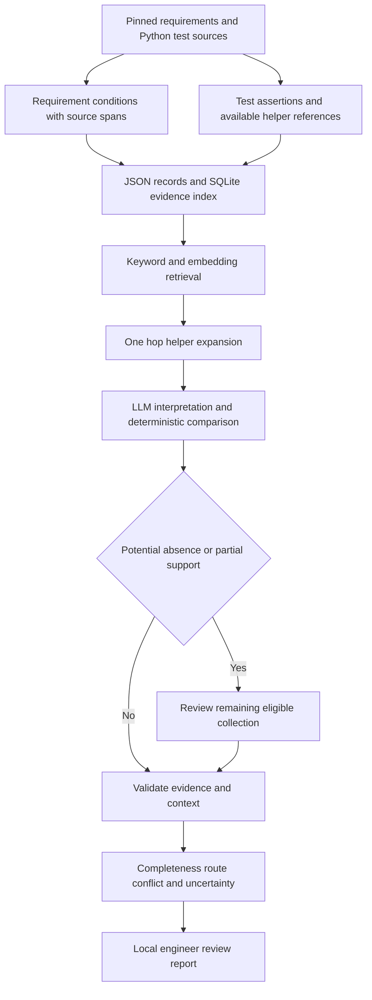

# Project architecture

Implemented now: source-span contracts, finding validation, SQLite storage and artificial CLI demonstration. Other blocks remain planned. Human labels and matched baselines form a separate evaluation workflow; system predictions must not be shown to independent annotators. Historical attribution remains optional and requires verified earlier alignment and later mismatch.
